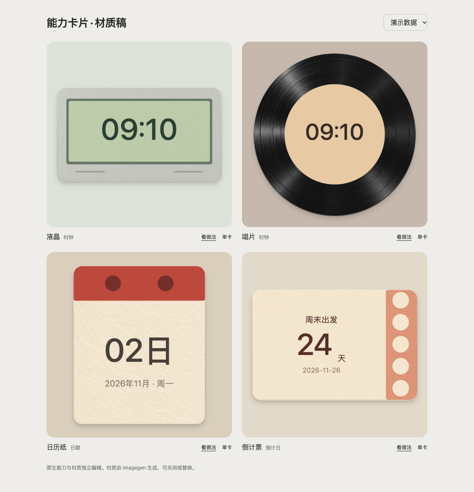

# 单能力卡片预设 · 材质稿

2026-10-31。这是旧方案的普通单卡材质研究。用户随后撤回必须手工复现的要求，最新方向为[有独立渲染的模板能力](../../research/template-preferences-2026-10-31/README.md)。吊牌与信号已从当前图库撤下，文件继续保留在历史研究中。其余四张仍是待评审研究稿。

## 历史样稿与当前候选

| 卡片 | 能力 | 独立可编辑内容 |
| --- | --- | --- |
| 液晶 | 时钟 | 磨砂机身、屏幕边框、底色、细纹、原生时间位置 |
| 唱片 | 时钟 | 圆形卡片、黑胶材质、中心标签、原生时间位置 |
| 信号（已撤下） | 时钟 | 椭圆卡片、磨砂层、三条斜线、原生时间位置 |
| 日历纸 | 日期 | 纸纤维、红色页头、装订点、原生日期位置 |
| 倒计票 | 倒计日 | 纸纤维、色带、五个圆点、原生标题/目标日期/天数 |
| 电量吊牌（已撤下） | 电量 | 椭圆卡片、磨砂层、环形装饰、原生电量位置 |

通过 HTTP 打开本目录 `index.html`。点“看做法”可开关各图层、调整材质透明度、修改图形颜色和能力位置，保存修改后的 `.fridge` 单卡。材质原图与提示词保存在 [materials/sources.json](materials/sources.json)，压缩的图片文件也可单独导入编辑器。

生成使用内置 image_gen，共三次独立生成：暖色纸纤维、黑胶同心纹路、灰色细磨砂塑料；没有生成能力数字、页面或完整模板。提示词与生成路径都保留在来源文件。运行材质只做等比下采样与 WebP 压缩；材质层沿用原来图片元素的透明度和宿主裁切。

## 接进产品的方式

在用户选择某个能力后展示该能力的卡片预设，包含“自定义 / 空白”。选择预设创建普通卡片并绑定用户数据；随后直接使用原来的编辑器。更换外观时迁移同能力的数据配置，保留用户课表、倒计目标等内容；替换形状/装饰/材质作为一次可撤销操作。模板无需独立固定模式。

图库同时可以提供可复用的纸、黑胶、塑料素材；用户在自己的创作中添加同款图片图层即可复现。预设配置只用当前 reader 已支持的字段；文件为 v1 `kind:card`。这次交付为设计样稿与可导入单卡，未添加 App 内预设菜单。

## 体积与验证

- 纸纤维 512²、33,860B；磨砂 512²、64,172B；黑胶 768²、108,162B。三种运行材质共 206,194B，当前四张候选嵌入材质共 240,054B；原来六张历史稿共 368,398B（约 360KiB）。完整原图在 `materials/sources/`，不装入卡片包。
- 导出只携带仍被使用的素材，取消材质层后不携带其闲置图片。原始生成文件和精简运行文件分别保留。
- 6 张卡 × 180/300px × 演示/未配置/长内容，36 份渲染；每个包经真实 reader 校验，只有一个能力。合成电量和倒计目标留在预览 fixture，导出不带。
- 网页验证图层开关、材质透明度、配色、位置、还原、导出后真实 reader 读取，以及 390px 窄屏。各卡 `.qa.json`、`gallery-qa.json` 与截图保留实际结果；原生 Form 验收为 false。

重建：`node build.cjs` → `node capture.cjs` → `node verify.cjs`。设计学习与素材决策见 [DESIGN-REFERENCES.md](DESIGN-REFERENCES.md)。
