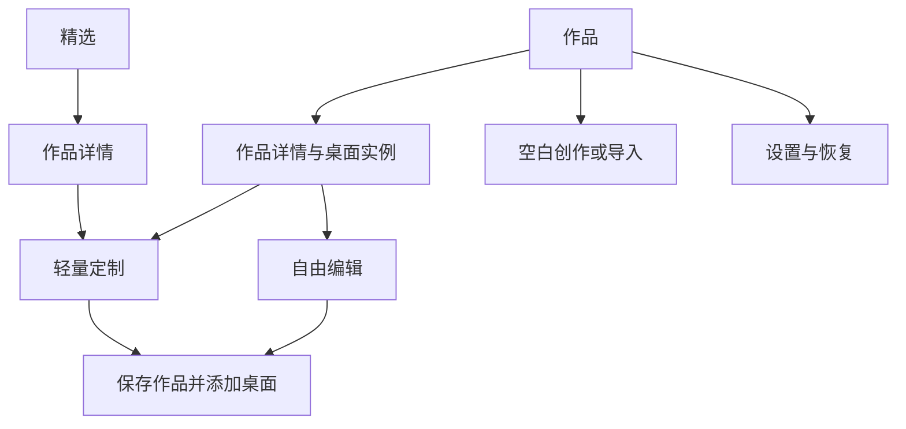

# 冰箱贴大版本产品与增长报告

日期：2026-11-09。目标：从个位数 MAU 增长到 1,000 MAU。对象：原生 HarmonyOS 手机与平板用户。代码观察基线：`cd7742a` 加模板改动；交付时这些改动已归入 `a9cd1dc`。

## 1. 建议采取的产品方向

冰箱贴已经有自由拼贴、照片抠图、课表、多尺寸画布和可编辑作品分享，功能基础相当完整。下一次大版本应围绕一个具体承诺组织：**让用户很快把自己的照片和日常信息，做成愿意长期放在桌面的作品。**

我建议将产品主线定为“个人照片与日常信息的桌面创作”，第一批重点服务喜欢个人照片、宠物、旅行记忆的用户；把学生的漂亮课表作为第二条获客与留存路径。自由创作服务愿意深入的用户，模板承担首次成功。

需要一起完成五件事：

1. **展示完整结果。** 从 44 款现有模板中整理出少量风格统一的作品系列，让用户先看到适合自己的桌面，再修改照片、颜色和内容。
2. **缩短主流程。** “选作品 → 换成我的内容 → 添加到桌面”成为默认路径；复杂图层编辑作为进阶入口。
3. **做一个有传播画面的鸿蒙玩法。** 首选可编辑作品交换与直接添加，逐步验证平板创作、手机使用的接续体验。专注实况窗作为独立候选。
4. **将恢复与迁移设为发布门槛。** 先补完整备份、恢复入口、未知字段保留和多进程迁移协调，再扩大用户量。
5. **把分发作为产品工作。** 商店首屏、可复用样例、内容发布和小规模用户观察要与开发同步。MAU 个位数阶段，漂亮的新界面还需要被目标用户看到。

建议本次大版本的核心交付：**两条可跑通的上手路径、三个有辨识度的设计系列、可靠的桌面添加、作品恢复和一项鸿蒙分享体验。** 暂缓社区、壁纸商城、天气后端、健康聚合和通用 AI 对话。

### 1.1 当前最值得优先处理的发现

| 发现 | 对产品的影响 | 建议 |
| --- | --- | --- |
| 本地构建最低兼容版本是 HarmonyOS 6.1.1 / API 24 | API 24 以下设备不能安装这个包；会直接影响可触达人数 | 将真实商店包与目标用户系统分布核对列为 P0，评估 API 18/20 等候选基线的适配成本 |
| 模板藏在“进入画布 → 添加卡片”后，按 13 类能力加组合分类 | 新用户先理解工具结构，才能判断是否喜欢成品 | 将成品发现前置，尺寸和能力作为筛选 |
| 当前模板插入立即进入通用编辑器 | 简单换照片也要面对画布、卡片、模板、数据等层级 | 增加轻量定制界面，沿用同一文档模型 |
| 库已有事务、冲突保护、三代校验快照；恢复读取函数没有产品调用点 | 用户遇到故障后缺少自助找回路径 | 恢复中心与完整私人备份优先交付 |
| 未知模板 ID / 未来模板版本经本地 normalize 后被移除 | 新版设计被撤下、回退旧包或跨版本恢复时可能损失样式配置 | 加原始字段保留与兼容写入门禁，保留历史 renderer |
| 首页和编辑逻辑集中于 3,211 行、130 个 `@State` 的 Index 页面 | 弹层、异步照片、导航和保存之间的状态联动复杂 | 按用户任务拆页面与编辑会话，分阶段迁移 |

最低版本描述针对当前本地配置；线上发行包的最低版本、商店曝光、安装转化目前没有导出数据。这三个数字应在动工第一周补齐。

## 2. 鸿蒙市场中的直接竞争

### 2.1 主要对手与应对方式

| 产品 | 已核对的原生依据及能力 | 用户选择它的理由 | 冰箱贴应争取的位置 |
| --- | --- | --- | --- |
| **灵动小组件** | 华为官方原生案例：日期、便签、相册、自定义、抠图、碰一碰与二维码分享；官方展示图已经包含自由摆放的照片主体 | 品类齐全、内容持续更新、能看到大量立即可用的效果 | 照片构图完成度、个人内容替换质量、短流程、原生编辑手感和恢复体验 |
| **亿象小组件鸿蒙版** | 开发者独立鸿蒙帮助：收藏内安装、桌面编辑、会员自定义与打卡；一键安装要求鸿蒙 5.1.0(18)+；开发者声明无广告 | 实用组件、干净体验、简单安装 | 精心设计的个人照片与信息组合、统一的尺寸适配、可编辑作品交付 |
| **轻倒数** | 华为官方原生案例：快速新建、桌面卡片、碰一碰与重力交互 | 单一任务做得快、有趣，重要日期的情绪价值清晰 | 纪念日与真实照片共同构图；一次配置在多个作品中使用 |
| **系统相册、日历、天气与主题能力** | 用户已有的默认替代品；具体卡片随系统版本变化 | 无额外安装、低学习成本 | 用户照片、字体、信息布局形成统一个人作品，减少来回配置 |

原生依据：[华为开发者案例，页面标注 2025 年 9 月](https://www.huawei.com/cn/huaweitech/publication/202503/small-medium-sized-developers-harmonyos)、[亿象鸿蒙教程](https://dw-docs.smarthao.com/#/hos/guides/index)、[亿象鸿蒙会员权益](https://dw-docs.smarthao.com/#/hos/posts/vip-content)。华为文章披露过灵动小组件 9 万 MAU，属于历史厂商案例数据；本报告的增长测算使用独立假设。

**抠图、无广告、碰一碰都已在直接竞品中出现。** 冰箱贴可以将它们做好，但用户真正记住的应是成品气质和操作体验。一个具体区隔是：给同一张不完美的生活照片，冰箱贴能快速生成主体完整、时间清楚、配色协调的桌面作品，并且保存后长期稳定。

### 2.2 商店网页观察与平台区分

这次重新打开华为应用市场“小组件”搜索，首屏出现 Colorful Widget、组件岛、iScreen、Top Widgets、YX Widget 等。打开 YX Widget 条目时，显示版本 `5.5.37_20261012`，更新说明包含 Android 14 适配；同一页面又有鸿蒙平板用户评论。该页面用于了解商店竞争表达与问题线索，鸿蒙功能以独立鸿蒙文档为准。[市场搜索](https://appgallery.huawei.com/search/%E5%B0%8F%E7%BB%84%E4%BB%B6)、[YX Widget 条目](https://appgallery.huawei.com/app/C108906373)。

当前可见的三条 YX 评论涉及基础免费功能、跨系统功能/权益差异、系统更新后重做布局。仓库 10 月 31 日研究还记录了三个市场条目共 75 条可见评价；它们适合确定访谈问题，不能用来估计原生鸿蒙用户故障率。[历史调研](/Users/macalan/Documents/project_x/FridgeMemo/research/2026-10-31-harmony-widgets.md)

Top Widgets、iScreen、Colorful Widget 进入商店展示与审美对照；这次可访问网页没有提供足以确认其当前鸿蒙原生安装包功能的资料，比较表中不填原生功能数量和价格。精确搜索“灵动小组件”返回了多个近似名称产品，原生案例的开发者为南京星梦之舟，后续实机体验应按开发者身份核对。

亿象鸿蒙 FAQ 中仍有较早的透明背景说明，页面没有注明对应系统版本；冰箱贴当前已声明 `transparencyEnabled: true`，透明效果按目标系统实测，不依据该旧 FAQ 决定能力。[亿象 FAQ](https://dw-docs.smarthao.com/#/hos/questions/index)

### 2.3 设计参考的具体启发

- **Widgetsmith：照片承载个人意义。** 官方桌面样例将城市照片、天气和快捷信息用同一色系组织，照片承担主视觉；开发者在 2023 年披露单张照片是当时最常配置的组件。适合借鉴“用户自己的内容 + 少量实用信息”。[官方展示](https://widgetsmith.app/)、[开发者文章](https://david-smith.org/blog/2023/09/18/widgetsmith-5-interactive-widgets/)
- **iScreen：用户购买的是整体桌面效果。** 官网按组件、主题、图标、壁纸组织成品，当前展示还包含冰箱题材。冰箱物件本身已有相近表达，品牌辨识要继续落实到构图、交互和内容。[官网](https://www.iscreenapp.com/)
- **灵动小组件：原生竞品已经将素材、抠图和传播放在同一产品链路。** 官方展示图中的素材库、作品分享和照片主体说明了其竞争方向；冰箱贴首屏也应展示完成后的作品，而不是先解释编辑器。

实际查看的图片、界面组织与采用的设计关系见 [设计参考记录](/Users/macalan/Documents/project_x/FridgeMemo/research/product-upgrade-2026-11-09/DESIGN-REFERENCES.md)。

## 3. 如何让用户觉得符合自己的 taste

### 3.1 先服务两类具体需求

| 人群假设 | 要完成的事 | 第一眼展示 | 再次使用的自然原因 | 优先级 |
| --- | --- | --- | --- | --- |
| 有宠物、伴侣、旅行照片，愿意装饰桌面的鸿蒙用户 | 让喜欢的照片变成好看的、带时间或日期的桌面 | 用户照片占主角的完整桌面 | 换照片、旅行后更新、纪念日、收藏的新样式 | 主线 |
| 使用鸿蒙手机/平板的学生 | 把课表放桌面，同时保持喜欢的风格 | 下一节课与本周安排的漂亮成品 | 调课、换学期、考试倒计时、调整周计划 | 第二条路径 |
| 喜欢设计和折腾桌面的创作者 | 自由组合并把作品交给别人继续编辑 | 图层自由度、真实编辑过程、可导入文件 | 创作、分享、改作品 | 保留进阶能力 |

第一类适合照片演示与传播，第二类适合形成长期需求。先分别观察两条路径，不将学生、情侣、二次元、商务、极简、宠物同时混成一个默认首页。

### 3.2 把风格做成系列

首发建议整理 **3 个系列、每个 4 个重点作品，共 12 个主推作品**。从现有 39 单卡与 5 组合中筛选和改进；其余作品进入全部目录，旧作品继续可用。

| 系列工作名 | 具体视觉语言 | 首批作品 | 个性化重点 |
| --- | --- | --- | --- |
| 照片留白 | 一张主照片、明确留白、主体可越过读数，少量日期文字；根据照片决定字色 | 景深时间、相片日历、相遇日期、旅行倒计时 | 照片、时间位置、日期、两到三套适配色 |
| 纸面日常 | 编辑式字体层级、纸面基线、日期与事项对齐；每张只有一个主要底面 | 日历海报、课程纸条、周课表、留白日程 | 课表/日程来源、强调色、主次信息 |
| 数字物件 | 统一数字字形、清楚的机械或电子物件逻辑、低信息噪声 | 翻页钟、电格、今日组合、桌边组合 | 深浅外观、数字格式、信息开关 |

系列需要覆盖 2×2、2×4、4×4 的合适变体；每种比例重新安排构图。组合继续是一张 card、一个共享底面、内部来源保存在 `template.sources`，遵循仓库模板规范。

**照片作品是推荐的主视觉；课表是推荐的高频用途。** 像素、玩具与随机小互动先作为一个小专题，观察使用与收藏后再增加投入。

### 3.3 taste 需要在使用中验证

“极简”“治愈”“高级”标签无法替代用户的真实选择。建议一次完成以下小规模研究：

1. 招募 12–15 名实际鸿蒙用户：照片/桌面装饰用户、学生、曾装过又删除组件的用户各约三分之一；允许多重身份，记录系统版本和设备。
2. 先看他们愿意展示的当前桌面，询问为什么保留某张卡片、最近删掉什么、上次换桌面何时发生。
3. 用 12 张完整桌面效果做盲选，混入直接竞品和冰箱贴候选，去掉品牌与价格。让用户选“真愿意放桌面”的两张，再用自己的照片替换。
4. 观察三个任务：生成照片作品、添加桌面、第二天修改内容。记录完成时间、返回次数、求助点与取消位置。
5. 7 天后追访：是否还保留、是否修改过、为何删除、是否主动给别人看。将选择理由与实际保留关联。

建议试验通过条件：12 人中至少 10 人独立完成照片模板添加，至少 8 人在第 7 天仍愿意保留。它们是小样本产品门槛，后续用更大 cohort 检验。

样式评分建议：照片/内容契合度 30%、一眼可读 25%、桌面整体协调 20%、个性化后仍完整 15%、分享意愿 10%。额外把“是否喜欢”与“能否完成操作”分别记录，避免用漂亮的展示图掩盖操作问题。

### 3.4 低成本个性化

- 新用户无需先填兴趣问卷；首屏展示照片、课表和完整精选作品。
- 收藏、使用、明确的“不喜欢”决定本地排序，允许清空偏好。最初用简单规则即可。
- 同一照片提供最多三个可靠构图建议，用户能直接看出差异；已有离线抠图、主体 alpha 和智能选位可以复用。
- 模板详情展示“换成自己的照片以后”的真实结果，包括横图、竖图、多人物、主体靠边等情况。
- 风格系列共享配色规则与字体层级；每张模板的关键控制随内容变化，照片模板不堆课表设置，课表模板不堆装饰按钮。
- 发布后保持每两周一小组作品的节奏，提前备好至少三次更新。初期可以通过现有作品包和版本更新交付；可下载内容只承载受校验的数据与素材，渲染代码随 App 发布。

## 4. UI 与操作体验重构

### 4.1 当前流程的问题

按当前代码，主要路径为：作品库 → 新建尺寸/名称 → 画布 → 添加卡片 → 模板/创作 → 能力分类 → 选模板 → 通用编辑 → 模板/数据配置 → 完成 → 返回画布 → 系统添加/编辑绑定。

用户需要提前理解的对象有画布、卡片、模板、组合、能力、图层、定时场景和桌面实例。尤其“添加卡片”同时承担选成品和创建元素，“模板”同时指可选样式与当前对象的外观面板。界面混乱与这些任务层级有关。

| 具体观察 | 所在位置 | 改进 |
| --- | --- | --- |
| 首次作品库以空画布开始，顶部和底部都有新建入口 | CanvasGallery；11 月 1 日原生截图 | 新用户展示成品与“用我的照片制作”，老用户保留作品入口 |
| 模板默认落在 clock 类别，分类为横向长条 | CardTemplatePicker | 先按系列/场景发现，能力和尺寸筛选放第二层 |
| 模板被加入当前画布后立即打开卡片编辑 | Index.createTemplate | 新建模板先在草稿里定制；确认后创建作品 |
| 配色、照片、铺满、背景归在同一个设置容器 | TemplateSettings | 轻定制只放关键内容与外观；铺满由使用场景决定默认值 |
| 手机/平板存在多个 sheet、popup、编辑返回状态 | Index | 一个导航栈管理任务；子任务返回有统一语义 |
| 同一主页面含 130 个 `@State` | Index | 把发现、作品、编辑会话、发布、恢复拆成明确边界 |

代码入口：[模板选择器](/Users/macalan/Documents/project_x/FridgeMemo/entry/src/main/ets/views/CardTemplatePicker.ets:10)、[创建模板](/Users/macalan/Documents/project_x/FridgeMemo/entry/src/main/ets/pages/Index.ets:1493)、[模板设置](/Users/macalan/Documents/project_x/FridgeMemo/entry/src/main/ets/views/TemplateSettings.ets:8)。11 月 1 日截图是历史视觉记录；照片构图当前已有独立编辑器，原来的无效滑块问题已有修复记录。

### 4.2 推荐信息架构

应用一级入口只保留 **“精选”和“作品”**。设置从作品页进入，包含备份与恢复、空间、帮助；暂时不设独立社区、消息、会员首页。

新用户默认进入精选；有作品的老用户默认进入作品或上次一级入口。升级后保留原作品顺序与进入路径，用一次可关闭提示介绍新入口。

“作品”是用户保存的结果；内部继续使用 canvas/card。模板是创建与改外观的方法。桌面实例属于作品的发布位置。无需为 UI 重构引入第二套文档、复制数据绑定或强制转成模板。

### 4.3 四个核心界面

**精选页**

- 首屏用一张主推成品展示完整桌面比例，后接两个入口：“用我的照片制作”“制作课表”。
- 下方以照片留白、纸面日常、数字物件组织系列，每个先露两到四张代表作品。
- 列表显示真实预览、名称和必要的尺寸/付费信息。需要外部数据时提前标明。
- 搜索和全部类型可找到现有功能；风格切换不再与能力选择混在一条长横栏。

**作品详情**

- 主预览可切换支持尺寸；不支持的比例不展示成“可用”。
- 一行说明可改的内容，例如照片、时间位置、配色；收藏为次要操作。
- 固定主按钮“制作同款”。从编辑器进入选样式时，按钮改为“使用这个样式”。
- 官方目录展示样式示例；换成用户照片后使用真实结果预览。

**轻量定制**

- 上半部稳定预览，下半部按需显示照片、内容、外观；一张模板通常三至五项核心控制。
- 照片用直接拖动/捏合调整，复用已实现的 TemplatePhotoEditor；时间避让建议显示为可预览选项。
- 课表显示“使用已有课表 / 导入课程”，导入仍沿用单 sheet 流程；失败可手动录入。
- 主按钮统一为“保存并添加”；已绑定作品显示“保存更改”。高级入口为“自由编辑”。
- 新建草稿取消不留下空作品；修改旧作品取消不改变原作。照片子编辑的取消只撤销该子任务。

**作品页与自由编辑**

- 作品按最近修改显示缩略图，可筛选“已放桌面”；尺寸进入筛选菜单，不占首屏主要视觉。
- 同一作品多个桌面实例在详情中按尺寸列出，显示本机可核对的绑定信息；系统侧核对失败时保留原记录。
- 自由编辑默认直接选取与拖动，底部四个明确入口：添加、图层、背景、更多。定时/轮换归作品设置。
- 选中元素后只出现相关属性；模板内部数据槽保持整体，不展开成虚构的独立图层。
- 平板/展开折叠屏采用左侧作品、右侧固定宽度检查器；短窗下让设置滚动，画布缩放与触控尺寸保持合理。

### 4.4 三条具体流程和目标

| 任务 | 建议流程 | 产品验收目标 |
| --- | --- | --- |
| 照片首作 | 用我的照片制作 → 系统选图 → 选择构图/微调 → 保存并添加 → 系统确认 | 主要 App 页面不超过 3 个；熟悉照片位置的用户中位时间 ≤ 60 秒，另记系统选图耗时 |
| 课表首作 | 制作课表 → 选择已有课表或导入 → 套用风格 → 保存并添加 | 已有课表用户 ≤ 60 秒；学校登录单独测量 |
| 修改已放桌面的作品 | 点击组件/作品 → 轻量定制 → 保存更改 | 不重新选作品、不重新绑定；取消与撤销行为一致 |

快捷添加使用系统提供的原生 UI，并在确认后关联当前作品和尺寸。取消保留本地作品且不生成虚假桌面绑定；新增实例不得改变其他实例。AddFormMenuItem 在本机 SDK 声明为 API 12 起提供，实际目标桌面支持、callback 与实例时序需用探针确认。[本机接口](/Applications/DevEco-Studio.app/Contents/sdk/default/openharmony/ets/api/@ohos.arkui.advanced.FormMenu.d.ets:46)

### 4.5 视觉与交互规范

应用工具界面保持原生 HDS 导航和控件，使用中性的浅/深底色。主操作色固定承担行动与选择，作品预览承担风格变化。普通列表不套多层容器；工具文字、层级、空间与用户作品分清。

标题建议 22–28vp，主要操作/正文 16vp，必要元信息 13–14vp，触控区域不少于 44vp；系统字体放大时允许重排。动画只用于连续的进入、返回与状态反馈，连续拖动不加额外布局缓动。对比度、屏幕朗读、减少动效、系统返回与键盘遮挡纳入同一验收。

每个修改会话对应一组明确命令：换照片、改构图、换样式、改来源、保存。异步任务携带 `canvasId/cardId/sessionId/revision`；失效任务丢弃结果。先把新入口接到原模型，再逐步迁移旧编辑页面，保留可测试的每一步。

## 5. 鸿蒙能力与有趣的专属体验

优先做能被用户看见、能在十秒演示中理解、能复用现有架构的能力。推荐一项核心与两项逐步扩展，避免一次引入多个后台服务。

### 5.1 第一项：交换一张可以继续编辑的冰箱贴

场景：用户将旅行照片做成桌面，朋友喜欢这个风格。打开作品分享，通过系统分享或受支持的碰一碰发送；对方看到真实预览，选择“用我的照片制作”，日期、课表等个人来源在接收端配置。

当前已有 `.fridge` 打包、图片分享、share extension、接收预览与数据清洗，主要新增工作是更好的分享前预览、接收后改编入口、碰一碰生命周期和失败回退。照片与文字会随作品包发送，应在分享预览中让发送者看清内容。

两种明确选项：分享作品（包含当前照片与装饰内容）；分享样式（生成可替换的照片占位，保留构图）。优先接通作品分享，再增加样式分享。现有公开分享会移除私人课表/日程/日期配置，继续沿用该机制。

鸿蒙基础：Share Kit / `harmonyShare.on('knockShare')` 与 `SharableTarget.share` 在本机 SDK 有公开声明；设备支持按 SysCap 判断。普通系统文件分享作为同一个流程的回退。[官方能力说明](https://developer.huawei.com/consumer/cn/doc/harmonyos-guides-V13/harmony-share-overview-V13/)

成功指标：分享意图到文件成功生成、接收打开率、接收后完成个性化比例。没有接收方回执的系统分享只记录“分享面板打开/文件生成”，不计为送达。

### 5.2 第二项：手机选照片，平板排版，手机放桌面

先把同一份作品在平板和折叠屏的编辑体验做好：大画布、右侧检查器、跨窗拖入图片、窗口变化时保留选择与草稿。下一阶段验证应用接续，将当前作品、素材清单和编辑状态传到另一台设备。

接续使用完成后的文档版本和素材哈希；来源设备保留原作，目标设备收到完整内容后再打开可编辑副本。目标设备自行创建本机桌面实例。接续产品化之前，用 `.fridge` 交换也能完成跨设备作品流转。

鸿蒙提供应用接续与跨设备拖拽等能力；实际可用设备组合与入口需按支持范围落实。[自由流转官方最佳实践](https://developer.huawei.com/consumer/cn/doc/best-practices/bpta-hopping/)

它适合成为后续品牌演示，开发优先级低于本机首次添加和迁移恢复。

### 5.3 第三项：会进入专注状态的桌面作品

在课表/书桌系列里增加用户主动开启的 25 分钟专注：开始时作品切换为安静的大数字，结束后恢复原来的桌面；进程重启后从持久化起止时间恢复状态。可选择专注实况窗，在锁屏和状态栏查看剩余时间。

当前官方实况窗 `TIMER` 支持工具类专注与番茄倒计时，并需申请权益；课程提醒、事项待办、会议日程、正计时列为不适用场景。因此，**课表显示继续使用服务卡片，实况窗仅用于用户主动开启的专注倒计时**。审批失败或关闭实况窗时保留 App 与卡片内完整专注流程。[当前 Live View Kit 文档](https://developer.huawei.com/consumer/cn/doc/HarmonyOS-Guides/liveview-introduction/)

这项要新增专注状态和中断恢复，不能直接把现有定时场景当作闹钟或通知系统。建议在照片与课表两条主流程稳定后实施。

### 5.4 能力排序与准入条件

| 能力 | 用户价值 | 当前条件 | 建议顺序 |
| --- | --- | --- | --- |
| 当前作品直接添加桌面 | 降低首次流失 | 本机 SDK 有 AddFormMenuItem；核对实例 callback 和尺寸 | P0 |
| 原生透明背景、主体抠图、窗口适配 | 个性化成品质量 | 项目已有；补目标系统/机型视觉矩阵 | P0 |
| 碰一碰交换可编辑作品 | 易演示、便于朋友分享 | Share Kit + 当前作品包；做设备支持与取消验证 | P1 |
| 平板创作、手机接续 | 多设备差异化 | 需要素材传输、完整提交、冲突与目标端版本检查 | P2 |
| 专注实况窗 | 有明确开始结束的重复需求 | 工具类场景、权益与真机验证；配套专注状态机 | P2 |
| 小艺打开某个作品、创建倒计日 | 降低返回成本 | **Intents Kit 当前仅面向企业开发者**；具体意图需匹配开放 Schema | 条件满足后 P2 |
| 元服务试玩 | 降低新客体验门槛 | 需要单独发布形态、能力范围和安装后交接方案 | 达到初步留存后 |
| 天气、步数、音乐控制 | 扩展功能 | 数据源、授权和维护成本各异 | 本次候选池 |

Intents Kit 的系统入口包括小艺对话、搜索与建议，当前文档明确个人开发者无法进行意图申请与注册。项目发行主体尚无资料，排期将此项视为条件候选。[官方 Intents Kit 简介](https://developer.huawei.com/consumer/cn/doc/harmonyos-guides/intents-introduction/)

低成本趣味候选保留“翻硬币”“今天吃什么”：一次点击、有限反馈、用户自己的选项。作为照片/书桌专题中的一个玩法测试，避免让每张卡片新增常驻计时器。

## 6. 从个位数 MAU 到 1,000 的增长路径

### 6.1 固定指标定义

目标主指标沿用可比较的 **App MAU：滚动 30 天内主动进入 App 前台的去重活跃安装**。本地无账号阶段按安装标识统计，报表写“活跃安装数”；未来有账户时另设账户去重口径，并保留历史可比指标。

同时观察三个能解释产品质量的指标：

- **首次价值完成率**：首次打开后 24 小时内，至少保存一件个性化作品，并确认新增一个有效桌面实例的比例。
- **核心操作月活**：30 天内有编辑、个性化、导入、分享或专注等主动操作的活跃安装数。
- **已确认绑定的安装数与使用回访**：分别统计本机可核对的桌面绑定、用户主动组件点击和访谈中的持续使用；后台刷新次数不计入 MAU。

卡片能持续发挥作用，而用户未必需要天天打开 App。增加月活的合理理由包括每月换作品、换照片、更新课表、修改纪念日和分享。避免设置签到、强制回 App 刷新或无关通知来制造打开次数。

### 6.2 用简单模型安排获客量

按自然月做规划，设：`M_t = N_t + r × M_(t-1) + R_t`。

- `N_t`：当月首次打开的新安装，已包含在当月 App MAU 中。
- `r`：上月活跃安装在当月再次进入前台的比例，需单独测量。
- `R_t`：上月未活跃、当月回来的老安装。
- 下表为容量测算，取初始活跃 0、复活 0、每月新增与回访率固定。`r` 是月度活跃重叠比例，D30 当日留存另行统计。

| 情景假设 | 每月首次打开 | 月度回访 r | 第 1 月 | 第 3 月 | 第 6 月 |
| --- | ---: | ---: | ---: | ---: | ---: |
| 较多获客、较低回访 | 700 | 35% | 700 | 1,031 | 1,075 |
| 中等获客、较高回访 | 450 | 60% | 450 | 882 | 1,073 |
| 较少获客、很高回访 | 350 | 75% | 350 | 809 | 1,151 |

这三组比例是规划假设。以中间情景分解：每月 2,250 次合格商店详情访问 × 25% 安装 × 80% 首次打开 ≈ 450 新安装；若 60% 完成首次价值，则每月约 270 人真正把作品放到桌面。60% 的月度回访对当前阶段要求较高，要由 cohort 决定实际采用哪条增长路径。

如果每月首次打开达到 450，而月度回访只有 25%，同一模型长期稳定在约 600 MAU。这时应同时提高获客与自然回访，不能只依赖发布当天的一次曝光。

### 6.3 先跨过三个门槛

| 阶段 | 核心工作 | 继续投入的门槛 | 规模与观察方式 |
| --- | --- | --- | --- |
| 个位数 → 50 | 两条上手路径、12 个重点作品、商店表达、小批体验 | 至少 20 名真实新用户完成观察；记录每个失败原因；12 人可用性测试达到 10 人独立完成 | 人工招募、逐人看任务、每周改最常见阻塞 |
| 50 → 200 | 稳定添加、每两周作品更新、两种获客内容 | 首次价值完成率目标 ≥ 60%；激活用户第 7 天保留桌面作品目标 ≥ 50%；升级零丢失 | 单独看照片/课表 cohort，记录人数与比例 |
| 200 → 1,000 | 扩大有效渠道、维持内容供给、分享与回访 | 持续 4 周有新激活增长；月度回访和渠道获客成本可解释；故障率稳定 | 再选择小额投放或更多设计合作，做重复 cohort |

以上是建议目标，尚无当前漏斗基线。前期每组人数较少时，用任务观察和连续 cohort 做决定；达到足够样本后再做分流实验。

### 6.4 获客应该具体怎么做

**华为应用市场是主落点。**

- 检查线上版本的最低系统、设备范围、类目、搜索可见性、安装失败和崩溃数据。当前仓库配置的 API 24 门槛值得优先核算。
- 商店第一张图展示“自己的照片 + 好看的时间/日期”的真实桌面结果；第二张展示三步完成；第三张展示课表；第四张展示原生分享/平板；第五张展示旧作品保留与恢复入口。
- 描述首段用照片小组件、课表、纪念日这些实际用途，给出原生鸿蒙适用范围。保持产品名一致，避免堆同类品牌关键词。
- 商店截图和演示都来自产品最终渲染，样式、字体与安装后结果对应；首发保留一个完整免费路径，用户完成前能看到全部付费范围。

**两条内容渠道先小规模验证。**

1. 照片路径：小红书、华为用户社区、桌面分享内容。短视频展示普通照片经过三步变为桌面作品，重点拍真实替换和操作。
2. 学生路径：校园用户、小范围课表体验、平板学习桌面内容。展示一份真实授权课表如何变成喜欢的样式，学校适配失败单独记录。

建议起步每周两条高质量演示、一份可复用作品；每两周一个小系列。每条内容使用可识别的样式 ID 或渠道标记，统计落地访问、首次打开、激活与次月回访。渠道能力允许时使用聚合归因，无法传递安装归因的渠道通过自愿来源选择补充，不做设备指纹拼接。

首批可以邀请 3–5 名小型创作者合作，每人贡献两件真正会用的作品。先验证“有人做、有人用、有人分享”的过程，再考虑社区和设计师平台。合作洽谈与内容发布属于后续执行，不包含在这次报告交付中。

### 6.5 自然回访与内容节奏

| 触发 | 用户得到的价值 | 产品动作 |
| --- | --- | --- |
| 新照片、旅行结束、宠物成长 | 把最近喜欢的生活内容换到桌面 | 最近使用样式直接换照片，保存到原绑定 |
| 月初/季节变化 | 有一套新的整体样式 | 精选新增小系列，收藏与上次偏好辅助排序 |
| 新学期或调课 | 桌面信息继续准确 | 更新共享课表来源，相关作品一起更新 |
| 纪念日前 | 更新照片与日期排版 | 自愿设置提醒；点击到对应作品 |
| 朋友分享作品 | 低成本得到喜欢的样式 | 接收预览 → 用我的内容制作 → 添加 |

通知应只服务用户明确选择的日期或内容订阅。初期可以靠 App 内新增内容与外部演示驱动回访，先观察是否真的有换作品需求。

### 6.6 最小事件表

建议新增 `first_open`、`template_view`、`customization_start`、`customization_save`、`publish_request`、`publish_confirmed`、`publish_cancelled`、`widget_open`、`share_prepared`、`import_completed`、`restore_completed`、`migration_result`。

事件携带 App/OS 版本、设备形态、样式 ID、尺寸、入口、耗时、结果码、去重会话 ID。确认添加必须用系统结果与绑定核对；重试不得重复计数。照片内容、课程文本、文件路径和个人日期不进入分析事件。分析故障不得阻塞保存与添加。

当前代码搜索没有找到完整的产品分析链路。前 50 人可以结合商店聚合数据、本地诊断与经同意的体验回访；扩展到 200–1,000 时再确定满足权限与产品隐私说明的分析接入。

## 7. 性能体验计划

### 7.1 保留现有优化基础

项目已有：作品库静态缩略图与可见项生成、首次读取并发限制、场景共享渲染、缓存指纹、照片离线处理、动态数据去重、SQLite 事务和异步快照。

10 月 20 日的历史真机记录，在同一平板三张画布、每版三次冷启动样本下，scene ready 中位数由 406ms 降到 304ms，App PSS 中位数约由 123.7MiB 降到 90.5MiB。该指标从 Ability 创建计时，数据集也早于这次模板改动；本次性能验收重新测“点图标到可操作作品”的端到端时间。[历史性能记录](/Users/macalan/Documents/project_x/FridgeMemo/tests/native/device-matrix-performance/README.md)

### 7.2 首批负载与测量

| 维度 | 代表场景 | 必须采集 |
| --- | --- | --- |
| 作品库规模 | 10 / 50 / 100 作品；照片与纯信息混合 | 冷启动、首个有效预览、首屏可操作、滚动帧耗时 |
| 单作品复杂度 | 1 / 8 / 16 卡；抠图、GIF、多个来源、横向组合 | 点击响应、拖动帧时间、保存延迟、解码与渲染次数 |
| 桌面实例 | 1 / 4 / 8 实例，同源和异源各一组 | provider 读取、IPC、updateForm、文件描述符、功耗 |
| 生命周期 | 30 分钟静置、锁屏唤醒、跨日、强杀重启 | 展示正确性、恢复延迟、后台任务与缓存增长 |
| 设备 | 最低支持 OS 手机、当前 OS 手机、平板、折叠/短窗 | 同一任务轨迹下的延迟、内存、视觉与交互 |

冷启动每种条件至少 20 次，交互测固定脚本 100 次，内存测连续进出编辑 30 次后的稳定区间；功耗对照保持亮度、网络、温度和系统状态一致，至少三轮 60 分钟。记录 release/debug 包、设备与系统构建号。

### 7.3 建议性能预算

以下是第一轮基线采集后的调优目标，发布前固定测试设备与数据集：

- 10/50 作品的常规数据集：图标点击到首页可操作 p95 ≤ 1.5 秒，已有缩略图优先展示；100 作品压力组目标 ≤ 2 秒。
- 普通点击到首个反馈 p95 ≤ 100ms；进入轻定制 p95 ≤ 500ms，照片重处理另报耗时和进度。
- 拖动的帧耗时按设备刷新率统计：60Hz 预算 16.7ms、120Hz 预算 8.3ms；目标交互区间超预算帧占比 < 1%，重点消除 > 50ms 卡顿。
- 停止输入后的持久化提交 p95 ≤ 300ms；用户收到完成反馈时，文档和必要素材已完成持久化。持续拖动只合并中间写入，明确保存与退出不能遗漏最后状态。
- 同一固定负载下 PSS 不高于发布基线 10%；连续 30 次进出后保留增长 ≤ 10MiB，并定位全部持续增长对象。图片解码按展示尺寸控制。
- 无数据变化时，图片重新准备与 `updateForm` 为 0；同一批次相同来源最多读取一次。缓存与恢复数据设独立字节预算。

内存和功耗绝对阈值需要最低设备的基线；不以高端平板单次数据代替所有机型目标。

### 7.4 最值得先测的热点

1. **多实例电量刷新。** 当前 WidgetProviderRefresh 对电量返回 2,000ms；一个持续可见实例理论每小时 1,800 次请求触发机会，四个为 7,200 次。此处是调度次数上界计算，实际有系统可见性与缓存影响。保持用户已认可的响应体验，优先合并同源读取、避免无变化投递，再用功耗对照决定策略。
2. **模板发现页预览。** 当前 picker 用 ForEach 与 TemplateFace 构建选中分类。新精选页采用静态缩略图、可见窗口加载与受控解码；只有详情/编辑运行实时预览。
3. **首页、编辑、桌面的一致性。** 继续让三个入口消费共享 scene，预览键包含文档与 renderer 版本。更换照片和配色应局部失效。
4. **异步照片与导航。** 取消的处理任务及时释放临时图和 PixelMap，旧结果不能进入新会话；降低反复进入的内存增长。
5. **保存与备份。** 事务完成后调度快照，拖动提交合并；完整迁移备份独立执行并提供进度。用户素材清理必须参考活动库、恢复点、草稿和正在分享的引用。

## 8. 无损升级与数据恢复

### 8.1 需要保全的数据清单

“无损”在验收中落实为以下内容与可编辑关系都保留：

| 类别 | 必须保留的内容 | 比对方法 |
| --- | --- | --- |
| 文档 | canvasId、cardId、elementId、名称、顺序、尺寸、比例 | ID 集合、语义 JSON 比对 |
| 布局与外观 | 坐标、旋转、层级、分组、隐藏、背景、画框、材质、模板配置 | 字段逐项比对 + 固定时间渲染 |
| 私人来源 | 课表、学期、调课、日程、纪念日、时区、来源引用 | 规范化后的语义比对 |
| 素材 | 原图、GIF、透明主体、用户生成轮廓及不可重建资源 | SHA-256、大小、解码验证 |
| 定时与轮换 | 规则、来源/目标作品 ID、时间、启用状态 | 引用闭合、边界日期回放 |
| 桌面关系 | formId、canvasId、尺寸、实例修订与删除标记 | 同机升级前后注册表比对 + 每实例显示 |
| 恢复数据 | 历史检查点、冲突草稿、删除恢复所需素材 | 可独立恢复、材料完整性 |
| 其他已发布状态 | 收藏、偏好、购买权益（如线上版本有） | 发布包清单盘点后加入断言 |

首页缩略图等可重建缓存允许重新生成；原始素材、用户编辑与绑定身份必须有对应的保留规则。

### 8.2 当前基础与具体缺口

当前 `LibraryStorage` 实现了真实事务、陈旧写入拒绝、目录一致性校验和冲突草稿；`LibraryBackup` 写带 SHA-256 的独立快照，保留三代。此次核心存储检查 4 组通过。

仍需补齐：

1. `readLibraryBackup()` 只有定义，产品入口没有调用；`library_drafts` 有写入与限量保留，缺恢复 UI。
2. 当前快照 payload 是 `values`，原图/GIF 等文件仍依赖原素材目录。完整私人备份应包含资产 manifest 和真实素材。
3. 三代按提交覆盖，连续操作可能很快失去早期恢复点。建议增加每日/升级前固定点，按可用空间设预算。
4. 多进程连接与后台 Form 写入需要共同遵守迁移/恢复状态及库代际。
5. module 当前只有 form、formEdit、share 扩展，没有 BackupExtensionAbility；系统备份接入需与本地一致性快照统一。
6. **未知模板配置丢失已复现。** 用当前已通过生成物校验的模型，将模板 ID 改为未知值或 version 改为 2，经 `normalizeState` 后卡片仍在，但 `template` 不再存在于序列化结果。正常已知模板保留。风险在未来模板撤下、回退旧包和跨版本恢复时触发。
7. 当前 CardTemplate 的 `version: 1` 表达协议版本，实例没有独立的设计 revision；目录内 CompositionDefinition 有 revision。未来重新设计同一 ID 时，应让旧作品明确使用原设计实现，避免无意改变构图。

相关代码：[存储](/Users/macalan/Documents/project_x/FridgeMemo/entry/src/main/ets/model/LibraryStorage.ets:23)、[备份](/Users/macalan/Documents/project_x/FridgeMemo/entry/src/main/ets/model/LibraryBackup.ets:7)、[模板归一化](/Users/macalan/Documents/project_x/FridgeMemo/entry/src/main/ets/model/CardTemplate.ets:74)、[文档读取](/Users/macalan/Documents/project_x/FridgeMemo/entry/src/main/ets/model/CardSchema.ets:279)。

### 8.3 推荐迁移策略

**UI 重构优先保持 state schema 2 与原 card/canvas/Form 身份。** 新入口、收藏与编辑器偏好采用兼容的附加元数据；模板新特性按能力逐项扩展。先升级读取与保存保护，再引入需要新字段的作品。

迁移步骤建议：

1. **盘点版本。** 保存所有可获得的线上正式包、签名身份、bundle/module/extension/form 名称、最低系统与 schema。发布 versionCode 必须高于实际线上版本。
2. **读前校验。** 区分全新安装、旧库、未知新库、损坏/暂不可读；未知格式保留原字节并进入兼容查看或恢复，禁止作为空库初始化。
3. **建立写入协调。** App、Form、分享接收、课表更新都通过同一存储入口检查迁移状态与 epoch。数据库内原子获取迁移所有权；阻止旧任务在提交后写入过期代。
4. **建立完整检查点。** 在一致性读取点保存目录、文档、私人来源、同机绑定快照与素材 manifest；素材从开始到验证完成纳入保留引用，校验字节和哈希。空间不足停止准备，继续使用旧库。
5. **隔离计算。** 在 staging 中运行版本化、幂等迁移。每个步骤有迁移 ID、输入版本、输出版本、源摘要与结果；新素材完整落盘后才可被文档引用。
6. **验证并提交。** 比较 IDs、语义数据、资产和绑定引用。若只是同库字段变更，用单库事务提交文档与迁移完成标记；保持独立 widget 注册表身份不变。确需多库更新时使用可恢复日志与协调协议，逐步验证，不假定两个文件同时替换具有原子性。
7. **重启与回放。** 进程在任一步被杀，重启只开放完整旧版本或完整新版本；迁移重复执行无副作用。完成后更新 epoch，再恢复编辑与桌面投递。
8. **延迟清理。** 发布后保留升级前完整检查点至少 30 天的建议窗口，用户可见；空间不足先清可重建缓存。保留期与空间预算在真实大库上验证，不能清掉唯一有效副本。

如果确实要更换数据库文件，必须关闭所有数据库连接并正确处理 WAL/SHM、同步目标目录；将它作为独立迁移项目。最小改动路径不做库文件热替换。

### 8.4 模板与历史作品兼容规则

- 已发布 template ID 不删除、不复用；可以从新建目录隐藏，历史 resolver 继续支持。
- 实例保存 `designRevision`，旧实例缺省映射到原 revision；新外观升级以“试用新样式/另存副本”给用户选择。
- 读取未知模板时保留原始 payload 与素材引用，显示可辨认的兼容预览；写入路径不将其归一化成普通卡片。先完成该保护，才可扩大格式能力。
- 旧自由拼贴、普通分组、已移动的组合保留。只有符合当前模板规范的完整预发布 `face-*` 才允许合并，保留主卡 ID，并检查定时布局引用。
- 分享格式 v1/v2/v3 继续可读；新格式明确版本。私人整库备份使用独立格式与版本，绕开 SharedCapability 的公开分享清洗。
- 同机覆盖升级保留原 formId/绑定/尺寸。跨设备导入或系统恢复到另一设备时，只恢复作品与来源，桌面实例按目标系统重新创建。

### 8.5 恢复中心的用户体验

入口：“作品 → 设置 → 备份与恢复”。展示最近一次完整备份、升级前检查点、删除作品和冲突草稿。用户能看见时间、名称、缩略图、缺失素材提示与“恢复为副本”。

普通恢复默认新建副本，避免覆盖当前有效编辑；整库灾难恢复使用校验过的备份准备新代，通过协调流程替换。无有效备份时提供重试和导出恢复材料。自动恢复成功后说明恢复到哪个时间点，保留失败原库供后续处理。

独立文件备份由系统文件选择器导出；“分享作品”与“完整备份”在产品里明确分成两个动作。云同步声明继续关闭，系统备份扩展与本地恢复单独验收。

### 8.6 升级测试矩阵与放量门槛

| 组别 | 必测条件 | 验收结果 |
| --- | --- | --- |
| 历史升级 | 可获得的 1.0/1.1/1.2 正式包 → 新包；覆盖安装；旧 XML 与 SQLite | 文档、私人数据、素材和同机绑定逐项保留 |
| 历史设计 | 自由拼贴、已修改旧组合、铺满模板、HTML、透明/GIF、多课表 | 可编辑、布局相符、来源正确 |
| 故障注入 | 每阶段强杀、空间不足、DB/WAL 锁、坏哈希、缺目录、部分素材 | 旧/新完整状态可恢复，无默认空库写回 |
| 并发 | App 编辑、Form 刷新、系统编辑与分享导入交错 | 陈旧写入拒绝，草稿可恢复，实例不串绑 |
| 版本兼容 | 未知 ID、未来字段、旧 renderer、重复迁移、热修复 | 原 payload 保留、历史外观可重现 |
| 系统恢复 | 新设备/已有数据设备、元数据和素材分批到达 | 完整校验后开放编辑，本机绑定策略明确 |
| 可见体验 | 三种尺寸各两个桌面实例、跨日、冷/热启动、横竖/短窗 | 原作和桌面可用，更新路径没有错绑 |

发布阻断条件：任何有效用户文档或原素材丢失、未知字段被清空、错绑、不可恢复半迁移、静默空库。关键语义字段与资产哈希要求 100% 一致；渲染比较冻结时间、电量、课表快照，并区分允许的抗锯齿差异与位置/内容变化。

当前规模适合用绝对人数放量：先 10–20 名有不同数据形态的体验用户，再 50、200，最后全量；发行渠道支持百分比分发后再使用百分比。每阶段至少覆盖一次冷启动、一次真实编辑和数天桌面使用。当前个位数用户应逐一获得可恢复检查点。

遇到问题先暂停新流量，关闭新入口或发保留当前读取器的热修复。**恢复旧 UI 时保留新版兼容存储层。** 直接安装不能识别新模板的旧包可能触发前述字段丢失，不作为默认回滚动作。

## 9. 分阶段实施与投入

以下为初步工程估算，假设一名熟悉现有代码的原生开发者，设计/研究部分投入；不是发布日期承诺。任务有依赖，建议把用户研究、API 探针和性能基线放到第一周，恢复与 UI 按可回滚小步推进。

| 阶段 | 交付 | 预计开发日 | 完成标准 |
| --- | --- | ---: | --- |
| A 产品基线与设计验证 | 商店包/系统门槛审计、漏斗定义、12 人研究、三条流程原型 | 4–6 | 两条目标人群路径明确，主要卡点可复现 |
| B 数据保护 | 未知 payload 保留、完整备份、恢复入口、迁移协调与故障注入 | 12–18 | 升级/恢复矩阵通过，损坏不覆盖 |
| C 核心 UX | 精选/作品、模板轻定制、编辑会话、明确保存与取消 | 12–18 | 照片、课表、老作品修改三条路径通过 |
| D 作品质量 | 12 个主推作品、比例/照片适配、历史 revision | 6–10 | 真实个人内容、空态/极端内容均可用 |
| E 添加与分享 | 原生添加、实例反馈、接收改编、碰一碰探针与接入 | 4–7 | 添加取消/重试不串绑，接收作品可编辑 |
| F 性能与发布 | 固定基线优化、正式包升级、设备矩阵、商店材料 | 7–10 | 发布阻断项清零，目标设备性能预算通过 |

总工作量约 **45–69 个开发日**，单人顺序推进约 **9–14 个工作周**；研究招募、设计制作与渠道内容另需持续投入。若时间紧，先削减接续、专注和新系列数量，保留恢复、添加和两条主流程。

### 9.1 建议发布顺序

1. 数据保护与测量先准备成兼容版本，建立现有用户检查点。
2. 新精选与轻定制内测，继续使用原文档与渲染能力。
3. 完成直接添加、12 个作品和分享；做真实旧包覆盖升级。
4. 同步更新商店页面、小规模发布内容，完成 50 人阶段。
5. 按照片/课表两条 cohort 决定继续扩展哪一条；第二批再接专注或跨设备创作。

### 9.2 优先级取舍

| 必须进本次 | 可以缩小 | 放到后续 |
| --- | --- | --- |
| 恢复与完整备份、未知字段保护、绑定保留 | 首发系列从 3 个减到 2 个 | 社区与账号体系 |
| 精选 → 定制 → 添加；老作品稳定编辑 | 初期分享只做 `.fridge`，碰一碰随后补 | 壁纸/图标商城 |
| API 最低版本/覆盖面审计、性能基线 | 全部目录继续复用旧分类作为次级入口 | 天气/健康/音乐数据聚合 |
| 商店演示与新客观察 | 静态高质量模板优先 | 元服务、接续、企业意图、专注实况窗 |

## 10. 交付检查与第一周任务

这次报告基于当前源码、历史真机记录、重新浏览的鸿蒙竞品资料和当前官方 API 文档。新执行的检查包括：

- `npm run test:storage`：4 个存储完整性套件通过。
- `npm run templates:check`：全部通过，包含 12,480 场景 / 90,720 文本槽位、400 组合场景、1,408 发布数据场景以及照片构图/取消回归。
- 合成兼容性探针：已知模板保留；未知 ID、未来 version 两种情况下模板字段被移除，已列入发布阻断任务。
- 阅读并对照 11 月 1 日原生作品库/编辑截图、当前模板代码与 10 月 20 日性能记录。

执行记录见 [核验记录](/Users/macalan/Documents/project_x/FridgeMemo/research/product-upgrade-2026-11-09/VERIFICATION.md)。本次交付为产品与技术方案，业务实现保持当前状态。

第一周最有价值的五项工作：

1. 导出线上包的最低系统、展示/安装/首次打开、机型与系统分布，核算 API 24 对可触达用户的影响。
2. 把未知模板保留和完整升级前检查点列入第一批工程变更。
3. 画完并试用“照片制作、课表制作、修改旧作品”三条流程，观察 12 名目标用户。
4. 用现有 renderer 选出 12 个主推作品，拿真实照片与课表检查替换质量。
5. 用一个最小原生探针验证直接添加、尺寸预选、确认/取消与 Form 绑定时序，并采集当前 release 性能基线。

**最终建议：以个人照片作品建立第一眼吸引力，以课表和日期建立持续用途，以可靠的保存、添加和恢复承接长期使用。增长目标按每月新增与真实回访逐步达成。**
